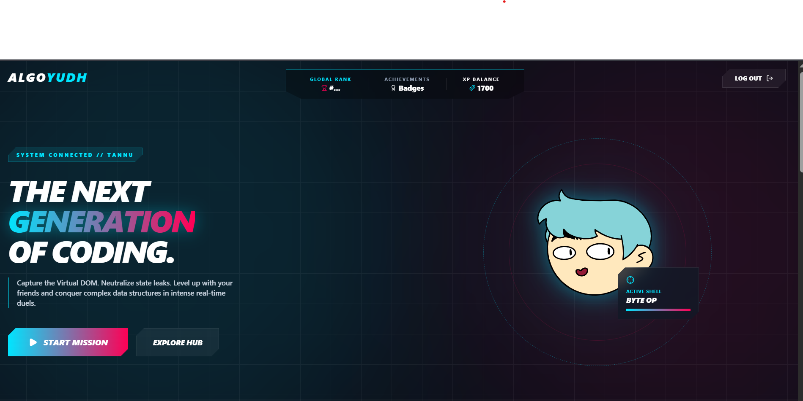
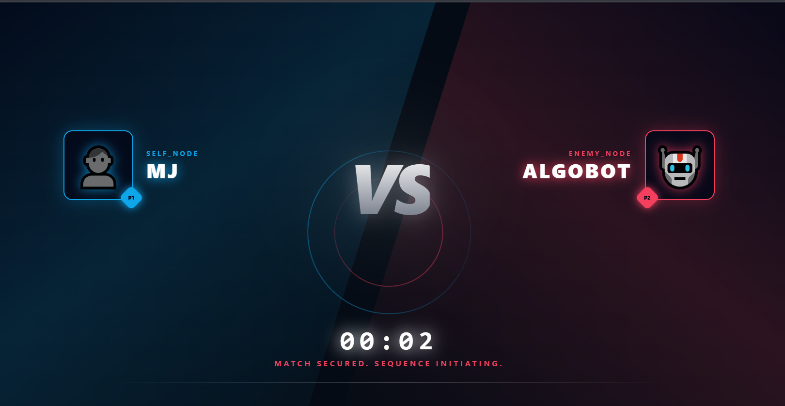
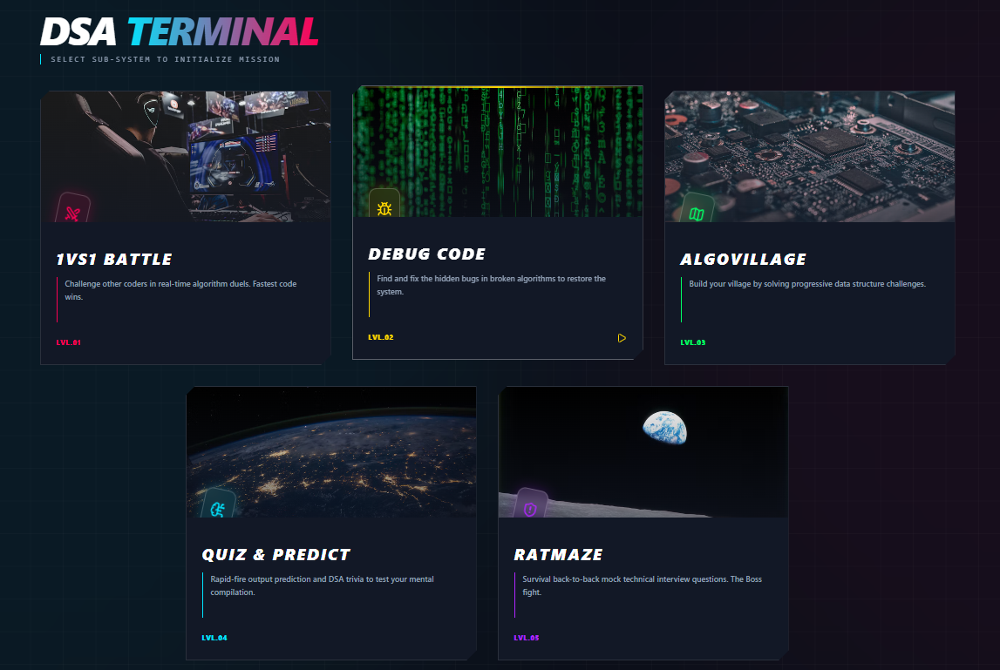
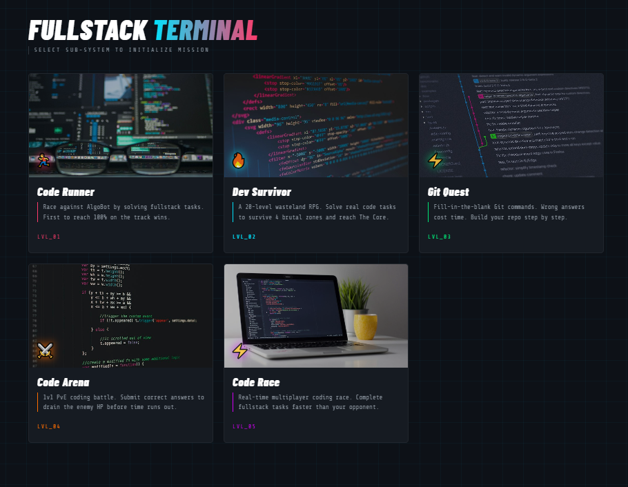

# ⚔️ AlgoYudh — A Gamified Coding & Learning Platform

<p align="center">
  <b>Code. Compete. Conquer.</b>
  <br/>
  A Gamified Learning Platform for DSA & Full Stack Development.
</p>

<p align="center">
  
  
  
</p>

---

## 🚀 Overview

**AlgoYudh** is a gamified coding and learning platform designed to make mastering Data Structures & Algorithms (DSA) and Full Stack Development more engaging, interactive, and rewarding.

It combines structured learning, coding challenges, progress tracking, and gamification to help developers build consistent coding habits, strengthen problem-solving skills, and grow as full stack developers.

## ✨ Key Features

- **📚 Structured Learning:** Organized learning resources for DSA and Full Stack Development.
- **💻 Coding Challenges:** Practice programming problems and improve problem-solving skills.
- **🏆 Gamification:** Earn rewards, track achievements, and stay motivated through coding milestones.
- **📊 Progress Tracking:** Monitor learning progress and track your coding journey.
- **🔥 Daily Coding Streaks:** Build consistency with daily coding practice.
- **🎯 Interactive Experience:** A user-friendly learning environment that encourages continuous improvement.

## 🛠️ Tech Stack

| Category | Technologies |
|---|---|
| Frontend | React.js, Tailwind CSS |
| Backend | Node.js, Express.js |
| Database | MongoDB |
| Real-time Communication | Socket.io |
| Authentication | JWT |
| Frontend Deployment | Vercel |
| Backend Deployment | Render |


## 📸 Project Screenshots

### 🏠 Home Page
<p align="center">
  
</p>

### ⚔️ AlgoYudh Platform
<p align="center">
  
</p>

### 💻 Data Structures & Algorithms
<p align="center">
  
</p>

### 🌐 Full Stack Development
<p align="center">
  
</p>


## ⚙️ Getting Started

Follow these steps to run AlgoYudh locally.

### 1. Clone the Repository

```bash
git clone https://github.com/your-username/algoyudh.git
cd algoyudh
```

### 2. Install Dependencies

For the frontend:

```bash
cd client
npm install
```

For the backend:

```bash
cd ../server
npm install
```

### 3. Configure Environment Variables

Create a `.env` file inside the backend directory and add the required configuration:

```env
PORT=5000
MONGO_URI=your_mongodb_connection_string
JWT_SECRET=your_jwt_secret
```

Add any additional environment variables required by your project.

### 4. Run the Application

Start the backend:

```bash
cd server
npm run dev
```

Start the frontend in another terminal:

```bash
cd client
npm run dev
```

The application will be available at the local URL displayed by your frontend development server.

## 🎯 Project Goals

- Make DSA learning more engaging through gamification.
- Encourage consistency through daily coding practice.
- Provide a structured path for learning full stack development.
- Help developers improve their technical and problem-solving skills.
- Create an interactive environment for continuous learning.

## 🔮 Future Enhancements

- Advanced leaderboards and competitive coding events.
- Personalized AI-powered learning recommendations.
- More coding challenges and difficulty levels.
- Enhanced analytics and performance insights.

## 👩‍💻 Author

**Milly Jain**

B.Tech Computer Science & Engineering

- GitHub: [millyjain09](https://github.com/millyjain09)
- LinkedIn: [Milly Jain](https://linkedin.com/in/milly-jain/)

---

<p align="center">
  <b>⚔️ Don't just learn to code. Train to conquer.</b>
  <br/>
  Made with ❤️ for developers who never stop learning.
</p>
